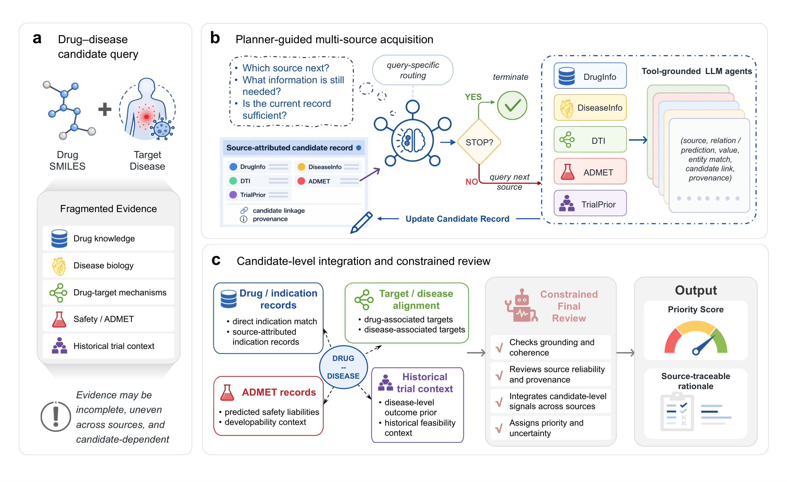
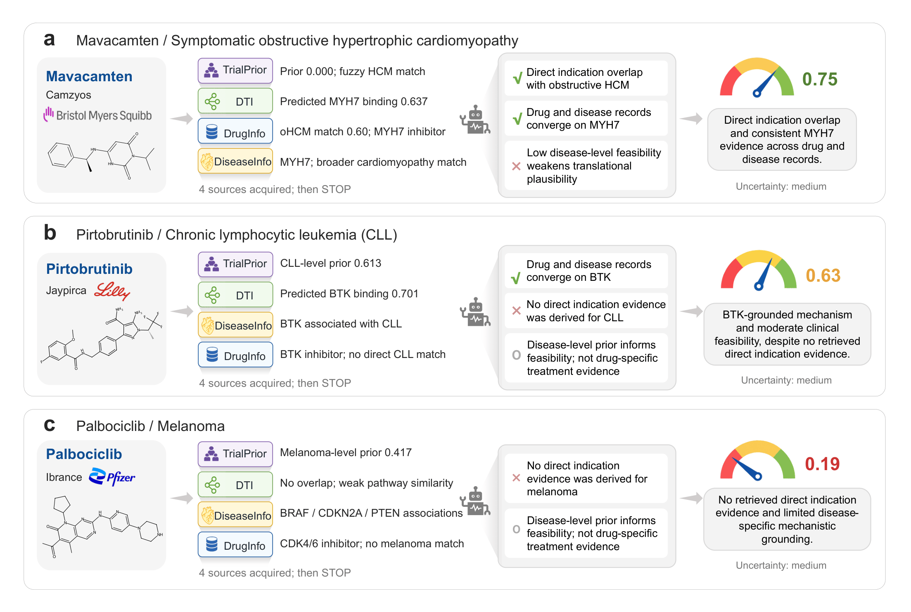

# TreatAgent

**Agentic Integration of Multi-Source Biomedical Evidence towards Explainable Drug Repurposing**

TreatAgent is an LLM-driven framework for **evidence-grounded drug repurposing prioritization**. Given a drug SMILES and a target disease, it adaptively acquires biomedical evidence, integrates source-attributed findings, and generates a continuous research-priority score with an inspectable rationale.

---

## Architecture



*Figure 1. TreatAgent workflow: planner-guided evidence acquisition, candidate-level integration, and constrained final review.*

TreatAgent combines five callable biomedical tools:

- **DrugInfo** — drug indications, targets, and pharmacological context.
- **DiseaseInfo** — disease normalization, associated targets, and pathways.
- **DTI** — drug–target interaction prediction.
- **ADMET** — molecular properties and developability-related predictions.
- **TrialPrior** — disease-level historical trial-outcome statistics derived from the training split.

A planner selects evidence sources, source-specific evidence agents interpret tool outputs, and a deterministic integration layer establishes candidate-level relationships. A constrained reviewer then produces the final priority score, uncertainty, and rationale.

---

## Representative cases



*Figure 4. Three representative candidate assessments.*

The examples illustrate complementary evidence patterns: Mavacamten–obstructive hypertrophic cardiomyopathy (0.75), Pirtobrutinib–CLL (0.63), and Palbociclib–melanoma (0.19).

---

## Installation & Quick Start

TreatAgent requires **Python 3.10**. Large model and data assets are managed with Git LFS.

```bash
git lfs install
git clone https://github.com/xinyaolai9-oss/TreatAgent.git
cd TreatAgent
git lfs pull

conda env create -f environment.yml
conda activate treatagent
```

Configure an LLM API endpoint:

```bash
export URL_VALUE="https://your-api-endpoint"
export API_VALUE="your-api-key"
```

Run the manuscript-style TreatAgent workflow on the DD test set:

```bash
export TREATAGENT_USE_LLM_PLANNER=1
export TREATAGENT_USE_LLM_EXPERTS=1
export TREATAGENT_USE_LLM_JUDGE=1
export TREATAGENT_FULL_PLANNER_BUDGET=5

python -m treatagent.cli \
  --json_path data/benchmark/splits/drug_disjoint_test.json \
  --method multiagent \
  --agent_version full \
  --backbone gpt-4 \
  --threshold 0.20
```

For the SS test set, replace the input path with `data/benchmark/splits/temporal_submit_test.json`. The CLI selects the corresponding training-derived TrialPrior mapping from the split filename.

The fixed-retrieval RAG+Tools baseline can be run with:

```bash
python -m treatagent.cli \
  --json_path data/benchmark/splits/drug_disjoint_test.json \
  --method rag --backbone gpt-4 --threshold 0.40
```

A local, non-LLM demonstration is available with `--agent_version eg --backbone local`; this is not the full manuscript workflow.

For a custom input, provide a JSON list containing `smiles` (or `canonical_smiles`) and `disease` (or `normalized_disease`) for each candidate.

---

## Data & Resources

The final benchmark contains:

- **2,160** drug–disease pairs: 1,106 positive and 1,054 negative.
- **828** unique drugs and **686** unique diseases.
- DD and SS train/validation/test splits, each containing 1,512 / 216 / 432 pairs.

Benchmark labels are inherited from clinical-trial primary-endpoint outcomes and serve as retrospective reference signals, not definitive evidence of therapeutic efficacy. TrialPrior is constructed separately from each training partition; validation and test labels are not used to build the priors.

The five tools use processed resources derived from DrugCentral, Mondo, Open Targets, UniProt, DeepPurpose, and ADMET-AI. Resource versions, data preparation details, and rebuild instructions are documented alongside the corresponding files under `data/`.

---

## Repository Structure

```text
TreatAgent/
├── assets/figures/    # Manuscript figures
├── treatagent/        # Core workflow, tools, prompts, and baselines
├── data/              # Benchmark splits and biomedical resources
├── results/           # Frozen predictions, source tables, and case studies
└── reproducibility/   # Result-audit and figure-generation utilities
```

## Citation

Citation metadata are provided in [`CITATION.cff`](CITATION.cff). Please cite the associated manuscript and the archived software release when available.

## License

Original TreatAgent source code is licensed under the [Apache License 2.0](LICENSE). Original project-authored documentation, figures, and result artifacts are licensed under [CC BY 4.0](LICENSES/CC-BY-4.0.txt), unless otherwise stated. Third-party datasets, derived biomedical resources, software dependencies, pretrained models, and checkpoints remain subject to their respective upstream terms and are not relicensed by this repository. See the [licensing scope](LICENSES/README.md) and [third-party notices](THIRD_PARTY_NOTICES.md) for details.
